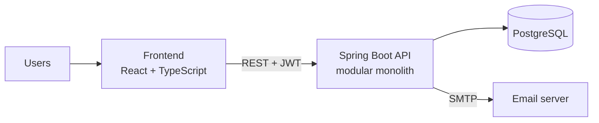

# C4 - Containers

Monolith modules: `auth`, `users`, `catalog`, `circulation`, `reservations`, `fines`, `history`, `notifications`.
`circulation` may use `catalog`, `users`, `reservations` and `fines`; the reverse is not allowed.
